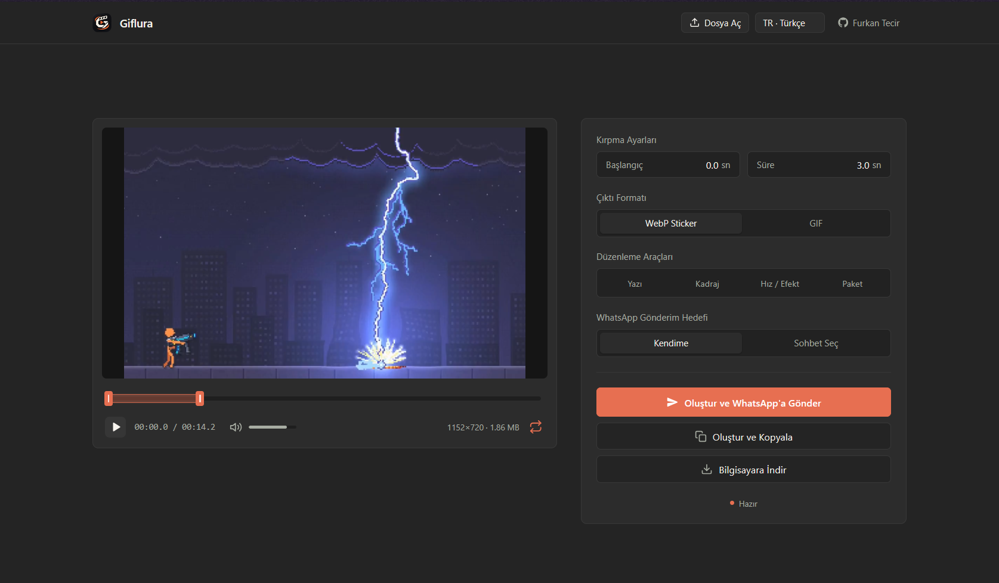

# Giflura

> X (Twitter) ve yerel videolardan doğrudan tarayıcınızda, tamamen çevrimdışı olarak kaliteli GIF'ler ve 512×512 hareketli WhatsApp çıkartmaları üretin.
>
> Turn X (Twitter) and local videos into animated WhatsApp stickers & high-quality GIFs directly in your browser — 100% offline.

  <!-- Chrome Web Store Butonu -->
  
  &nbsp;&nbsp;&nbsp;&nbsp;
  <!-- Firefox Add-ons Butonu -->
  

  

---

## Türkçe

### Giflura Nedir?

Giflura; Google Chrome, Mozilla Firefox ve Zen Browser üzerinde çalışan, gizlilik odaklı ve tamamen istemci tarafında (tarayıcınızda) çalışan bir medya stüdyosu eklentisidir.

X (Twitter) üzerinde gezinirken karşılaştığınız videolardan veya bilgisayarınızdaki yerel medya dosyalarından tek tıkla **gerçek çok kareli `.gif`** ve WhatsApp standartlarına uygun **512×512 hareketli çıkartma (`.webp`)** oluşturmanızı sağlar.

Uzantı, yerel WebAssembly (FFmpeg WASM) altyapısını kullanır. Dosyalarınız hiçbir uzak sunucuya yüklenmez, işleme tamamen kendi cihazınızın donanımı üzerinde gerçekleşir.

---

### Öne Çıkan Özellikler

- **X (Twitter) Üzerinde Tek Tıkla Yakalama:** Video oynatıcıların üzerinde ve tweet aksiyon çubuğunda beliren butonla videoyu doğrudan stüdyoya aktarır.
- **Yerel Dosya Desteği:** Bilgisayarınızdaki `.mp4`, `.webm`, `.mov`, `.gif` veya hareketli `.webp` dosyalarını sürükleyip bırakarak düzenleyebilirsiniz.
- **WhatsApp Web Entegrasyonu:**
  - **Kendime Ekle (Varsayılan):** Oluşturulan hareketli çıkartmayı tek tıkla kendi WhatsApp `(Siz)` sohbetinize gönderir. Çıkartma saniyeler içinde telefonunuzdaki ve masaüstünüzdeki WhatsApp çıkartma panelinde yerini alır.
  - **Sohbet Seçimi:** Çıkartmayı rehberinizdeki herhangi bir kişiye veya gruba doğrudan gönderebilirsiniz.
  - **Panoya Kopyalama:** Stüdyoda çıkartmayı kopyalayıp WhatsApp Web'de açık olan herhangi bir sohbette `Ctrl+V` ile çıkartma formatında yapıştırabilirsiniz.
- **Zaman Çizelgesi ve Kırpma:** Milisaniye hassasiyetinde başlangıç ve bitiş aralığı belirleme.
- **Kadraj Kontrolleri:** Sığdır (Fit), 1:1 Kare veya serbest Bölge Kırpma (Crop & Zoom).
- **Meme / Yazı Katmanı:** Üst ve alt başlık desteği, beyaz ve sarı yazı stilleri, siyah dış çizgi ve canlı önizleme.
- **Oynatma Hızları ve Efektler:** 1x, 1.5x, 2x hızlandırma; ileri-geri döngü (Boomerang) ve ters oynatma seçenekleri.
- **Çıkartma Paketi Oluşturucu:** 30 adede kadar çıkartmayı pakette toplayıp WhatsApp'a toplu aktarma veya `.wastickers` / `.zip` olarak dışa aktarma.
- **Gizlilik ve Çevrimdışı Çalışma:** Sıfır telemetri, sıfır veri toplama, sıfır sunucu bağımlılığı. İnternet bağlantınız olmasa dahi çalışır.
- **Çoklu Dil Desteği:** Türkçe, İngilizce, İspanyolca, Arapça (sağdan sola RTL düzeni), Çince, Japonca ve Korece.

---

### Nasıl Kullanılır?

1. Yukarıdaki mağaza butonlarını kullanarak tarayıcınıza uygun sürümü (Chrome veya Firefox) yükleyin.
2. X (Twitter) üzerinde herhangi bir videonun üzerindeki "GIF / Sticker" butonuna tıklayın ya da tarayıcı araç çubuğundaki Giflura simgesine basıp bilgisayarınızdan bir dosya yükleyin.
3. Açılan stüdyoda kırpma, kadraj, hız ve metin ayarlarınızı yapın.
4. "GIF İndir", "WhatsApp Çıkartması İndir" veya "WhatsApp'a Ekle" butonlarından birini seçin.

---

### Gizlilik ve Güvenlik

- Giflura hiçbir kullanıcı verisini, geçmişini veya medya dosyasını toplamaz, kaydetmez veya iletmez.
- Tüm dönüştürme ve kodlama işlemleri tarayıcınızın kendi bellek alanında (sandbox) WebAssembly aracılığıyla gerçekleşir.
- Uzak kod (remote code) barındırmaz.

---

## English

### What is Giflura?

Giflura is a privacy-first, client-side browser extension designed for Google Chrome, Mozilla Firefox, and Zen Browser. It allows you to convert videos from X (Twitter) or files from your computer into **real multi-frame GIFs** and **512×512 animated WhatsApp stickers (`.webp`)** directly inside your browser.

Powered by single-threaded WebAssembly (FFmpeg WASM), all encoding processes run locally on your device without ever uploading media to external servers.

---

### Key Features

- **One-Click Capture on X (Twitter):** Instantly captures media from tweet video players and action bars.
- **Local File Support:** Drag and drop `.mp4`, `.webm`, `.mov`, `.gif`, or animated `.webp` files straight from your desktop.
- **Direct WhatsApp Web Integration:**
  - **Message Yourself (Default):** Adds the animated sticker directly to your personal chat with a single click, instantly syncing across your mobile and desktop WhatsApp trays.
  - **Select Chat:** Search contacts and groups to deliver stickers directly.
  - **Copy & Paste:** Copy in the studio and paste (`Ctrl+V`) into any WhatsApp Web chat as a native animated sticker.
- **Timeline Trimming:** Precise start and end point controls.
- **Framing Modes:** Fit, 1:1 Square, or custom Crop & Zoom area selection.
- **Caption & Meme Overlays:** Top and bottom text overlays with outline styling and live preview.
- **Speed & Playback Effects:** 1x, 1.5x, 2x speeds, Boomerang (forward-reverse loop), and Reverse playback.
- **Sticker Pack Manager:** Collect up to 30 stickers in a tray and export as `.wastickers`, standard `.zip`, or send the entire pack to WhatsApp.
- **100% Offline & Private:** No servers, no accounts, no analytics, no tracking.
- **Internationalization:** 7 languages (English, Turkish, Spanish, Arabic with full RTL support, Chinese, Japanese, and Korean).

---

### How to Use

1. Install Giflura using the Chrome Web Store or Firefox Add-ons button above.
2. Click the "GIF / Sticker" button above any video on X (Twitter), or click the Giflura toolbar icon to import a local video file.
3. Fine-tune your clip using the trimming handles, framing options, speed controls, or captions.
4. Export as a high-quality GIF, download the `.webp` sticker, or send it directly to WhatsApp Web.

---

## Geliştirici / Developer

- **Furkan Tecir**
- Web: [furkantecir.com.tr](https://furkantecir.com.tr)
- GitHub: [@furkantecir](https://github.com/furkantecir)

---

## Lisans / License

Telif Hakkı (c) Furkan Tecir. Tüm hakları saklıdır.  
Giflura, resmi mağazalar üzerinden ücretsiz olarak dağıtılan tescilli bir yazılımdır. Kaynak kodlar halka açık değildir ve izinsiz çoğaltılamaz veya yeniden dağıtılamaz.

Copyright (c) Furkan Tecir. All rights reserved.  
Giflura is proprietary software distributed for free via official browser stores. Source code is closed and may not be reproduced or redistributed without permission.

